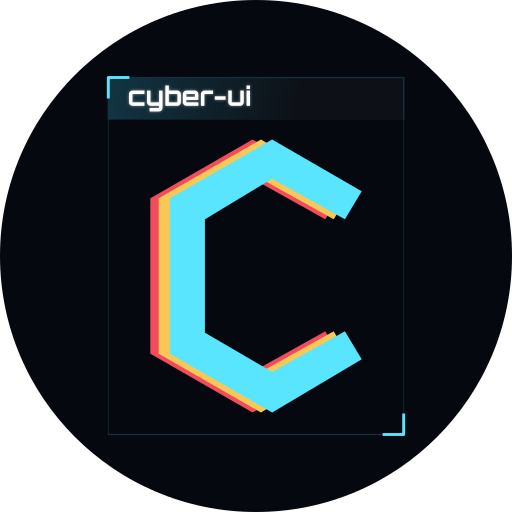

<p align="center">
  
</p>

[](https://www.npmjs.com/package/@jgawlik/cyber-ui)
[](https://github.com/jakub-gawlik/cyber-ui/actions/workflows/ci.yml)

Cyberpunk / Stellaris inspired UI components for any web project: a zero-JS
CSS core plus Lit web components, published as `@jgawlik/cyber-ui`.

**Usage docs, component catalog and live demo: [cyberui.art](https://cyberui.art)**

This repository is the library source. The rest of this README is for working
on it.

## Development

```sh
npm install
npx playwright install chromium  # first run only, for the browser tests
npm run typecheck
npm run test                     # Vitest browser suite (headless Chromium)
npm run build                    # dist/cyber-ui.js + dist/cyber-ui.css + types
```

Framework integration smoke apps live in `smoke/react` and `smoke/vue`
(`npm run pack:smoke`, then build the app against the tarball).

Architecture in one line: component styles are authored once in
`src/styles/components/*.css` and consumed twice — bundled into the global
`cyber-ui.css`, and imported (`?inline`) into the matching Lit element's shadow
root — so the class version and the element version can't drift apart.

Repo layout, conventions, scripts, CI and the release procedure:
[docs/architecture.md](docs/architecture.md). Release notes:
[CHANGELOG.md](CHANGELOG.md).

## License

MIT
